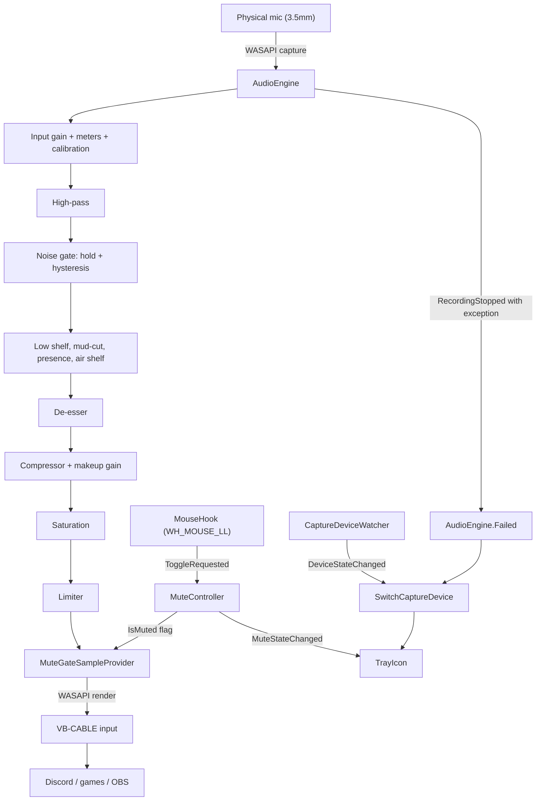
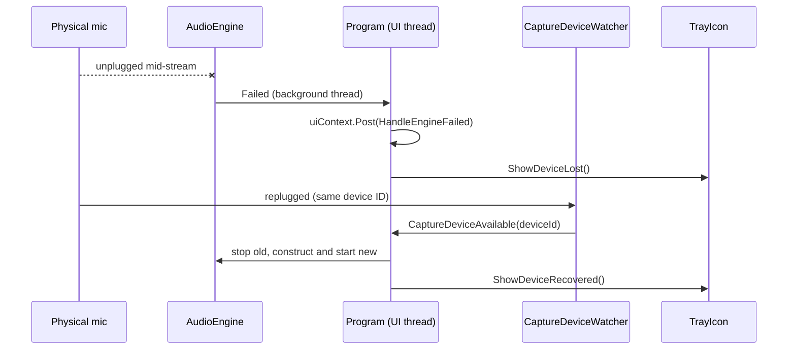

# NoelMic

(repo: noelmic-discord-virtual-mic-dsp)

*Captures a microphone on Windows, runs it through a real-time DSP chain, and hands the result to Discord as a virtual microphone.*


A Logitech PRO X's USB DAC can fail without killing the microphone: the capsule still works over the motherboard's 3.5mm jack. What dies with the DAC is everything downstream of it, namely Blue VO!CE's processing and the physical mute button, with no software equivalent short of new hardware.

NoelMic captures the surviving mic through WASAPI, runs it through a chain of DSP stages, and renders the result into a VB-CABLE virtual input. Discord, games and OBS see an ordinary microphone named "CABLE Output". A low-level mouse hook catches an extra mouse button system-wide and flips a silence gate inside the same chain, which restores the hardware mute button without touching the device's own mute state.

The first defaults were not tuned by ear, and a live Discord call showed it: the voice came out boxy and quiet. Checking the chain against broadcast-audio references found three compounding mistakes. The noise gate had no hold time or hysteresis and chattered on every pause. The compressor had no makeup gain, so processed speech was quieter than the raw signal. The EQ boosted presence but never cut the low-mid mud. The fix was to correct all three and add named presets, so the chain can be A/B tested against a raw passthrough.

## Features

**WASAPI passthrough** — captures the physical mic with NAudio's WASAPI wrapper and renders to VB-CABLE's input endpoint.

**Composable DSP chain** — input gain, level meter, calibration meter, high-pass, noise gate (hold and hysteresis), low shelf, mud-cut, presence, air shelf, de-esser, compressor with makeup gain and dry/wet mix, saturation, and a hard-ceiling limiter, built as nested `ISampleProvider` wrappers. Filter and envelope state is allocated once at construction, not per buffer.

**Five presets** — `Raw`, `Natural`, `Broadcast`, `Warm`, `Bright` (`Config/PresetDefinitions.cs`). `Raw` is a near-passthrough for A/B comparison. Unknown preset names fall back to `Broadcast`, so a typo in `config.json` never blocks startup.

**Gain calibration** — a five-second pass measures the speech level while you talk and computes the input gain needed to reach a -18 dBFS target.

**Live metering and parameter updates** — the Settings dialog reads input and output levels, gate state, and compressor and de-esser reduction, and applies parameter changes to the running chain.

**Global mouse-button mute** — a `WH_MOUSE_LL` hook catches a configurable extra mouse button regardless of which window has focus. Muting writes silence into the render buffer from inside the chain and never reads or writes the Core Audio endpoint's mute state.

**Device recovery** — when WASAPI reports a real device error, `AudioEngine.Failed` fires; `CaptureDeviceWatcher` restores capture on the same device ID if it comes back and stays down without crashing if it does not.

**Tray UI** — a `NotifyIcon` with mic-on, mic-off and disconnected states drawn at runtime with `System.Drawing`, so no image assets ship. The Settings dialog covers device, toggle button, preset, and Windows startup registration (HKCU Run key).

## How it works





### Key decisions

- **Mouse hook rides `Application.Run()`'s pump**: `WH_MOUSE_LL` callbacks arrive on the installing thread's message loop. Installing the hook before `Application.Run()` avoids a second `GetMessage`/`DispatchMessage` loop competing on the same thread.
- **Mute never calls `IAudioEndpointVolume.SetMute`**: mute is a flag that gates the render buffer inside the chain, so nothing outside the app can observe or be surprised by it.
- **Gate hold and hysteresis over a bare threshold**: a single threshold chattered during natural pauses, confirmed in a live call. A hold time plus a gap between open and close thresholds stops the flapping without lookahead latency.
- **Makeup gain as a separate final multiply**: folding static gain into the compressor's attack and release smoothing would let it interact with the gain-reduction timing.
- **Every stage always constructed**: presets differ in coefficients, never in topology, so switching presets never rebuilds the chain and a no-op stage is just a unity filter.
- **Reference comparison of parameters, not structural equality**: the chain compares the active parameter record by reference on each buffer, and recomputes coefficients only when a settings change swaps in a new record.
- **NAudio 3.0.1 kept on `WasapiCapture`/`WasapiOut`**: they are flagged obsolete, but the replacement builder APIs use a different `IAsyncEnumerable` capture model, which is a rewrite rather than a swap. `CS0618` is suppressed on purpose.

## Tech stack

| Technology | Role | Why |
| --- | --- | --- |
| .NET 10 (`net10.0-windows`) | Runtime | — |
| NAudio / NAudio.Wasapi | WASAPI capture and render, device enumeration | — |
| WinForms | Tray icon, Settings dialog, message pump | Gives `NotifyIcon` and a native Win32 message loop for the mouse hook |
| VB-CABLE | Virtual audio endpoint | Free virtual-cable driver; must be installed separately |
| System.Text.Json | Config serialization | In the base library |
| xUnit | Tests | — |

## Getting started

Requirements: Windows 10 or 11, the [.NET 10 SDK](https://dotnet.microsoft.com/download/dotnet/10.0), and [VB-CABLE](https://vb-audio.com/Cable/). NoelMic looks for VB-CABLE by device name at startup and shows an error with a download link if it is missing.

```bash
dotnet build
dotnet run --project NoelMic.csproj
```

The first launch selects the system's default communications mic and writes `%APPDATA%\NoelMic\config.json`. The app runs from the tray: right-click the icon for mute, Settings and Exit. In Discord, pick "CABLE Output" as the input device.

```bash
dotnet test NoelMic.Tests\NoelMic.Tests.csproj
dotnet publish -r win-x64 --self-contained
```

## Configuration

`%APPDATA%\NoelMic\config.json` is created on first run. Most fields have defaults supplied by the selected preset; a field you set overrides the preset.

| Field | Default | Description |
| --- | --- | --- |
| `inputDeviceId` | auto-detected | Windows device ID of the capture mic; set it in the Settings dialog |
| `toggleButton` | `XButton1` | Mouse button that toggles mute: `XButton1` or `XButton2` |
| `startWithWindows` | `true` | Adds or removes an HKCU Run key |
| `playSoundOnToggle` | `true` | System sound on mute and unmute |
| `preset` | `Broadcast` | `Raw`, `Natural`, `Broadcast`, `Warm` or `Bright` |
| `inputGainDb`, `saturationDrive` | from preset | Overrides for the preset values |
| `eq`, `compressor`, `gate`, `limiter`, `deEsser` | from preset | Per-stage overrides |

`dspEnabled` is a legacy flag: a config with `false` is migrated to the `Raw` preset on load.

## Testing

```bash
dotnet test NoelMic.Tests\NoelMic.Tests.csproj
```

xUnit covers filter coefficients and biquad behavior, gate, compressor, limiter, de-esser, saturation, input gain, level and calibration metering, the composed chain, preset resolution, config round-trips, startup registration, and the mouse hook's toggle logic. Real-device behavior (WASAPI, VB-CABLE, the hook inside games) is verified by hand.

## Roadmap

| Status | Item |
| --- | --- |
| Done | WASAPI passthrough, DSP chain, presets, calibration, metering, global mute toggle |
| Done | Tray UI, Settings dialog, startup registration, device disconnect and reconnect recovery |
| In progress | Optional RNNoise noise suppression stage in front of the chain |
| Planned | Verification in fullscreen-exclusive games and OBS; only Discord is confirmed |

## License

**Source-available, not open source.** NoelMic is published under the
[PolyForm Strict License 1.0.0](LICENSE): you may read, run, and learn from the code
for personal, research, or evaluation use.

You may **not** use it commercially, redistribute it, rebrand it, or publish modified
versions without written permission. Copyright (c) 2026 Yassine Krichen. All rights
not granted by the license are reserved.

For commercial licensing or collaboration: krichenyassine22@gmail.com
