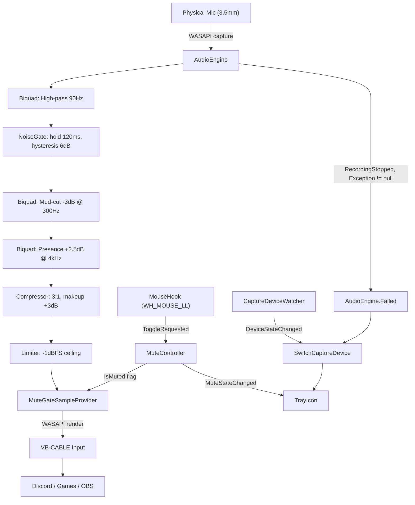
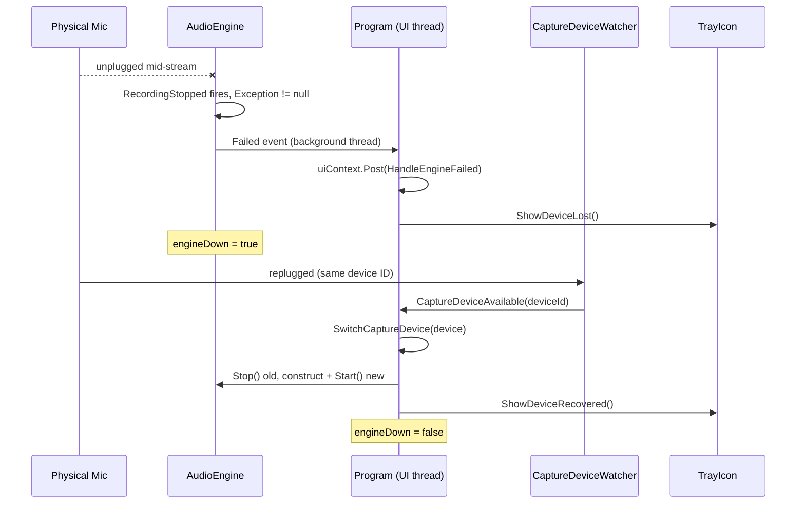

<div align="center">
  
  <h1>
    NoelMic <sup><sub>v1.0</sub></sup>
  </h1>
  <p>
    <em>Captures a dead USB soundcard's surviving 3.5mm mic, runs it through a real-time DSP chain, and hands it to Discord as a virtual microphone.</em>
  </p>
  <br />


</div>

A Logitech PRO X's USB DAC can fail without killing the microphone — the capsule still works fine over the motherboard's 3.5mm jack. What dies with the DAC is everything downstream of it: Blue VO!CE's processing and the physical mute button, both gone, with no software equivalent unless you buy new hardware.

NoelMic captures the surviving 3.5mm mic via WASAPI, runs it through a five-stage real-time DSP chain, and renders the result into a VB-CABLE virtual input. Discord, games, and OBS see an ordinary microphone named "CABLE Output" — none of them know a DSP chain sat in between. A low-level mouse hook catches an extra mouse button system-wide and flips a silence gate inside that same chain, restoring the hardware mute button's muscle memory without ever touching the physical device's own mute state.

The DSP defaults shipped without ear-tuning, and a live Discord call proved it: friends described the result as "talking from a toilet." Root-causing it against real broadcast-audio references (not guesswork) turned up three compounding mistakes — a noise gate with no hold time or hysteresis chattering on every pause, a compressor with zero makeup gain making every processed word quieter than the raw signal, and an EQ that only boosted presence without ever cutting the low-mid mud making the tone boxy. Fixing all three, rather than reverting the chain outright, is the harder but more defensible call — a mic processor that can't survive its own defaults isn't worth keeping.

Built for one dead USB soundcard, but the pattern — capture → composable `ISampleProvider` DSP chain → virtual cable — generalizes to anyone replacing a broken USB audio interface without buying new hardware.

## Features

**Audio Pipeline**

**WASAPI passthrough** — captures the physical mic via NAudio's WASAPI wrapper and renders directly to VB-CABLE's input endpoint; any app that can pick a microphone sees the processed signal as "CABLE Output."

**Five-stage DSP chain** — high-pass filter, noise gate (hold + hysteresis), mud-cut and presence EQ, compressor with makeup gain, and a hard-ceiling limiter, composed as nested `ISampleProvider` wrappers with per-channel filter/envelope state allocated once at construction, never per buffer.

**DSP bypass toggle** — `dspEnabled: false` in config.json swaps back to raw passthrough for A/B comparison without a rebuild.

**Mute Control**

**Global mouse-button toggle** — a `WH_MOUSE_LL` low-level hook catches a configurable extra mouse button regardless of which window has focus, including fullscreen-exclusive games.

**Mute never touches hardware** — muting writes silence into the render buffer from inside the DSP chain; the physical Core Audio endpoint's mute state is never read or written.

**Resilience**

**Device disconnect/reconnect** — `AudioEngine.Failed` fires when WASAPI's `RecordingStopped`/`PlaybackStopped` report a genuine device error (not a clean stop); `CaptureDeviceWatcher` auto-recovers onto the same device ID if it comes back, and stays down (without crashing) if it doesn't.

**Config persists across restarts** — device selection, toggle button, and every DSP parameter round-trip through `%APPDATA%\NoelMic\config.json`.

**Tray UI**

**NotifyIcon with live mute state** — icon swaps between mic-on, mic-off, and disconnected art, generated at runtime via `System.Drawing` — no bundled image assets.

**Settings dialog** — pick input device, toggle button, and Windows startup registration (HKCU Run key) without editing JSON by hand.

## Demo


_Mic-on, mic-off, and disconnected states — generated at runtime, no image assets shipped._


_Device, toggle button, and startup options — the only place config.json needs a human touch._

## How It Works

### Signal path



### Device disconnect and recovery



### Key Decisions

- **Mouse hook rides `Application.Run()`'s pump instead of owning one**: `WH_MOUSE_LL` delivers callbacks synchronously on the thread that installed it, during that thread's message loop. Installing the hook before `Application.Run()` starts — rather than building a separate `GetMessage`/`DispatchMessage` loop — avoids two competing pumps on the same thread.
- **Mute never calls `IAudioEndpointVolume.SetMute`**: mute state lives entirely as a boolean flag that gates the render buffer inside the DSP chain. The physical Core Audio endpoint's mute state is never touched, so nothing outside this app can observe or be surprised by it.
- **Gate hold + hysteresis over a bare threshold**: a single threshold caused audible chatter during natural speech pauses, confirmed live. A ~120ms hold plus a 6dB gap between the open and close thresholds eliminates the flapping without adding lookahead latency.
- **Makeup gain applied as a fixed post-multiply, not blended into the envelope loop**: folding a static gain into the compressor's attack/release smoothing would let it interact with the reduction ballistics. Keeping it a separate final step guarantees the compressor's timing stays exactly as tuned, independent of the gain-restoration amount.
- **NAudio 3.0.1 pinned despite `WasapiCapture`/`WasapiOut` being obsolete-flagged**: the replacement `WasapiRecorderBuilder`/`WasapiPlayerBuilder` APIs use a different, `IAsyncEnumerable`-based capture model — a real rewrite for equivalent behavior, not a drop-in swap. `CS0618` is suppressed deliberately rather than migrated.

## Tech Stack

| Technology | Role | Why |
| --- | --- | --- |
| .NET 10 (`net10.0-windows`) | Runtime | Current LTS (Nov 2025 – Nov 2028); NAudio 3.x requires 9.0+ |
| NAudio 3.0.1 / NAudio.Wasapi | WASAPI capture/render, Core Audio device enumeration | — |
| WinForms | Tray icon, Settings dialog, message pump | Simplest UI layer that gives `NotifyIcon` and a native Win32 message loop for the mouse hook |
| VB-CABLE | Virtual audio endpoint | The established free virtual-cable driver on Windows; assumed pre-installed |
| System.Text.Json | Config serialization | Already in the BCL — no dependency needed |
| xUnit | Test framework | 46 tests over DSP math, config I/O, mouse-hook logic, and startup registration |

## Getting Started

### Prerequisites

- Windows 10 or 11 (WASAPI, WinForms, and the mouse hook are all Windows-only)
- [.NET 10 SDK](https://dotnet.microsoft.com/download/dotnet/10.0)
- [VB-CABLE](https://vb-audio.com/Cable/) installed — NoelMic detects it by device name at startup and shows a clear error with a download link if it's missing

### Clone

```bash
git clone <repo-url>
cd noelmic
```

### Build

```bash
dotnet build
```

### Run

```bash
dotnet run --project NoelMic.csproj
```

First launch auto-selects your system's default communications mic and writes `%APPDATA%\NoelMic\config.json`. NoelMic runs entirely from the tray — right-click the icon for mute toggle, Settings, and Exit.

### Test

```bash
dotnet test NoelMic.Tests\NoelMic.Tests.csproj
```

### Publish (single self-contained exe)

```bash
dotnet publish -r win-x64 --self-contained
```

## Configuration

Auto-generated at `%APPDATA%\NoelMic\config.json` on first run. Edit and restart NoelMic to apply changes — values load once at startup, not hot-reloaded.

| Field | Default | Description |
| --- | --- | --- |
| `inputDeviceId` | *(auto-detected)* | Windows device ID of the capture mic; set via the Settings dialog, not by hand |
| `toggleButton` | `XButton1` | Mouse button that toggles mute — `XButton1` or `XButton2` |
| `startWithWindows` | `true` | Registers/removes a HKCU Run key on startup |
| `playSoundOnToggle` | `true` | Plays a system sound cue on mute/unmute |
| `dspEnabled` | `true` | Full DSP chain bypass — `false` gives raw passthrough for A/B testing |
| `eq.highpassHz` | `90` | High-pass cutoff — removes rumble/pop below this frequency |
| `eq.mudCutHz` / `eq.mudCutDb` | `300` / `-3` | Low-mid cut that removes boxy/muddy tone |
| `eq.presenceHz` / `eq.presenceBoostDb` | `4000` / `2.5` | Presence boost band |
| `compressor.ratio` / `compressor.thresholdDb` | `3.0` / `-18` | Compression ratio and threshold |
| `compressor.makeupGainDb` | `3.0` | Gain restored after compression |
| `gate.thresholdDb` | `-45` | Level below which the gate closes |
| `gate.hysteresisDb` | `6.0` | Gap between the open and close thresholds — prevents chatter |
| `gate.holdMs` | `120` | Minimum time the gate stays open after level drops, before it's allowed to close |

## Roadmap

| Status | Item |
| --- | --- |
| ✅ | WASAPI passthrough, DSP chain, global mute toggle |
| ✅ | Tray UI, Settings dialog, HKCU startup registration |
| ✅ | Device disconnect/reconnect resilience |
| ✅ | Gate hold/hysteresis, compressor makeup gain, mud-cut EQ |
| 🔲 | De-esser — skipped for v1; add only if harshness is reported after the current EQ/gate fixes |
| 🔲 | Live config reload — currently requires an app restart to pick up `config.json` edits |
| 🔲 | Fullscreen-exclusive game and OBS focus verification — Discord-tested, these two scenarios from the original spec are still unconfirmed |

## License

MIT © 2026 yassine krichen

---

Built by yassine krichen · 2026

## Before You Publish

- [ ] Add `docs/cover.png` — generate with: *"NoelMic — a minimal audio signal chain diagram on a dark background, waveform flowing through discrete processing blocks into a cable icon. Dark UI, high contrast, professional software screenshot aesthetic. Wide banner format, 1400×600px. No people. No text overlays."*
- [ ] Add `docs/demo/tray-icon.png` and `docs/demo/settings.png` — screenshots of the tray icon states and Settings dialog, referenced in the Demo section
- [ ] Add a `LICENSE` file at the repo root with the text below — no LICENSE file exists yet; MIT fits a single-author solo project with no SaaS/payment surface
- [ ] Replace `<repo-url>` in Getting Started once this is pushed to a real remote

```
MIT License

Copyright (c) 2026 yassine krichen

Permission is hereby granted, free of charge, to any person obtaining a copy
of this software and associated documentation files (the "Software"), to deal
in the Software without restriction, including without limitation the rights
to use, copy, modify, merge, publish, distribute, sublicense, and/or sell
copies of the Software, and to permit persons to whom the Software is
furnished to do so, subject to the following conditions:

The above copyright notice and this permission notice shall be included in all
copies or substantial portions of the Software.

THE SOFTWARE IS PROVIDED "AS IS", WITHOUT WARRANTY OF ANY KIND, EXPRESS OR
IMPLIED, INCLUDING BUT NOT LIMITED TO THE WARRANTIES OF MERCHANTABILITY,
FITNESS FOR A PARTICULAR PURPOSE AND NONINFRINGEMENT. IN NO EVENT SHALL THE
AUTHORS OR COPYRIGHT HOLDERS BE LIABLE FOR ANY CLAIM, DAMAGES OR OTHER
LIABILITY, WHETHER IN AN ACTION OF CONTRACT, TORT OR OTHERWISE, ARISING FROM,
OUT OF OR IN CONNECTION WITH THE SOFTWARE OR THE USE OR OTHER DEALINGS IN THE
SOFTWARE.
```
